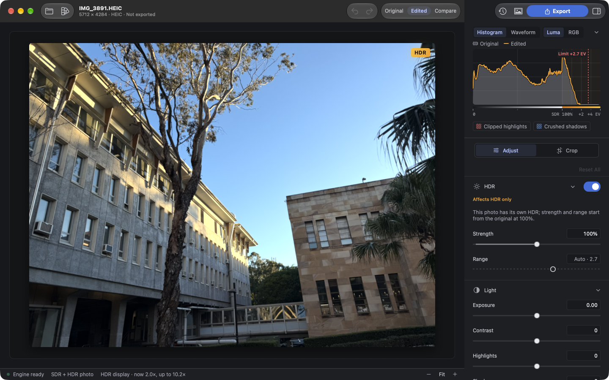
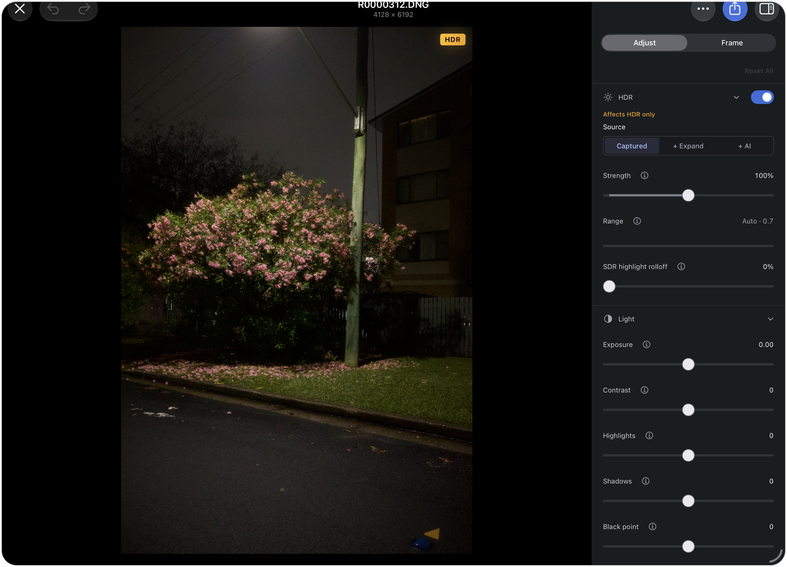
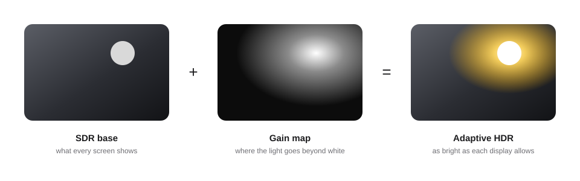
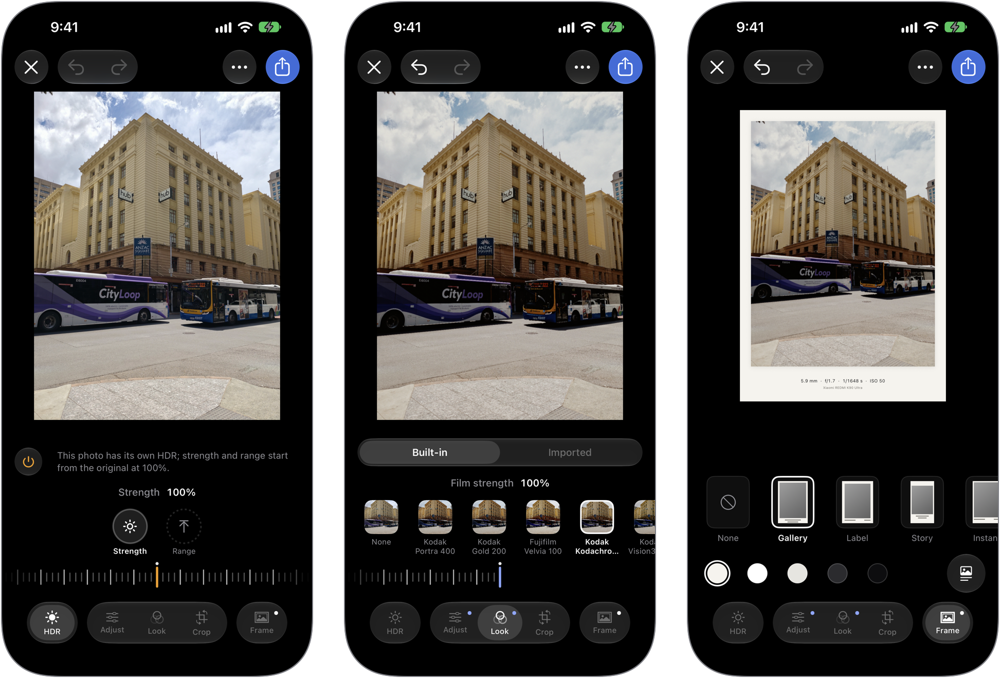
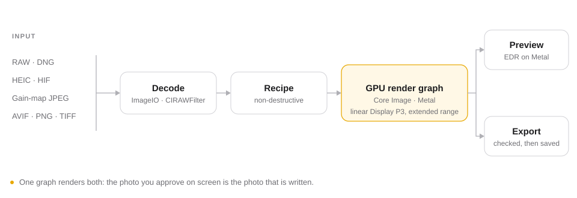

<p align="center">
  
</p>

<h1 align="center">HyperDR</h1>

<p align="center">
  <b>HDR photo editing, end to end.</b><br>
  iPhone · iPad · Mac
</p>

<p align="center">
  English&nbsp;&nbsp;·&nbsp;&nbsp;<a href="README.zh-CN.md">简体中文</a>
</p>

<p align="center">
  <a href="https://github.com/wsnxxxs/HyperDR/releases">Download for Mac</a>&nbsp;&nbsp;·&nbsp;&nbsp;<a href="apps/apple/README-iOS.md">Build for iPhone &amp; iPad</a>&nbsp;&nbsp;·&nbsp;&nbsp;<a href="CHANGELOG.md">What’s new</a>
</p>

<br>

<p align="center">
  
</p>

<br>

Photos from today’s iPhones and cameras hold highlights brighter than white, and
the screens of Macs, iPhones and iPads can really light them up. Most editors
flatten the photo into SDR the moment you touch a slider, and that light is
gone. HyperDR keeps it — from the camera file to the exported photo — and shows
it at your display’s real brightness while you edit.

<br>

## HDR is the subject, not an afterthought

The canvas is a Metal EDR layer, so highlights glow on screen as far as your
display allows. Hold the canvas to see the original, or split the view to
compare. HDR has its own source and its own controls:

- **Captured** — the highlights your camera actually recorded, from RAW, HIF, HEIC or gain-map files.
- **+ Expand** — stretch what is there into more headroom.
- **+ AI** — an on-device neural network infers highlights the file never stored.

Controls marked *Affects HDR only* shape the highlights without touching the SDR
picture underneath, so both versions stay right.

### A network that brings HDR back to ordinary photos

Many photos carry no HDR information at all: an ordinary JPEG, an image saved
from the web, an old photo from years ago. HyperDR ships a small convolutional
network we trained for one job — look at an SDR photo and infer how bright its
highlights should have been. It learned from HDR photos rendered by Apple’s own
devices and their gain maps, so it lifts highlights the restrained, natural way
Apple does instead of brightening the whole picture.

The model has about 635,000 parameters and runs on the device through Core ML.
Its prediction is a starting point: shape it with strength,
range and where the expansion starts, or let it add only what a photo with
captured highlights is missing. It always infers from the same development, so
a look or LUT chosen later never pulls it off course.

The trained weights are not published. A build from this repository offers
Captured and Expand, and shows the AI sources as unavailable.

<br>

<p align="center">
  
</p>

<p align="center"><sub>The Studio on iPad</sub></p>

<br>

## Looks from film, LUTs that know their colour space

- **Film** — twenty stocks: colour negatives (Kodak Portra 160 / 400 / 800, pushed 800, Ektar 100, Gold 200, UltraMax 400; Fujifilm Pro 400H, C200, X-TRA 400), slides (Fujifilm Velvia 100, Provia 100F; Kodak Kodachrome 64, Ektachrome 100) and motion-picture negatives (Kodak Vision3 50D / 250D / 200T / 500T, Verita 200D). Turn off a stock’s antihalation layer for the red highlight bloom of motion-picture film with its backing removed, as CineStill does to Vision3 500T.
- **Grain and halation** — computed from the emulsion’s physical scatter, not overlaid, and available on every photo, with or without a look.
- **LUTs** — import `.cube` files into HyperDR’s own library. Every LUT remembers its input and output space, and a LUT whose input the photo cannot supply is disabled rather than forced on as if it were sRGB.
- **Camera Log** — LUTs for S-Log3, V-Log, F-Log2, LogC3, LogC4 or Canon Log 3 are fed from a scene-linear RAW development, with the file’s baseline exposure kept and gamut compression off, so middle grey lands where the curve expects it.

While you choose, every look is rendered on your own photo. Strength mixes in
linear light, and a look changes colour and the SDR picture while the HDR
highlights are kept.

<br>

## Exports that look right on every screen

<p align="center">
  
</p>

Adaptive HDR stores the SDR picture you graded plus an ISO 21496-1 gain map. An
ordinary screen shows the SDR picture; an HDR screen lifts the highlights as far
as it can. Pick what the photo is for — Web, Social or Photos — and HyperDR
chooses the format, size and quality; change any setting to make a format of
your own.

| Output | Encoding |
|---|---|
| **Adaptive HDR HEIC** | SDR base + ISO 21496-1 gain map, HEVC |
| **Gain-map JPEG** | SDR base + ISO 21496-1 gain map |
| **HDR HEIC · AVIF** | PQ or HLG, 10-bit |
| **SDR** | JPEG · HEIC · TIFF |

### Frames for showing the work

<p align="center">
  
</p>

Gallery, Label, Story, Hairline and Instant mats in five paper tones, with an
optional shadow and a caption read from the photo’s own EXIF — camera, lens,
aperture, shutter speed. The paper is written with exactly zero gain, so on an
HDR display only the photograph lights up and the mat stays a calm paper white.
The Mac’s Frame panel and the iPad’s export lightbox preview the framed photo
on a live EDR canvas, exactly as it will be written.

<br>

## What you approve is what is written

<p align="center">
  
</p>

Preview and export run through the same GPU render graph — Core Image plus our
own Metal kernels, in linear Display P3 with extended range. There is no
separate export engine that reinterprets your edit. Crop, rotation, perspective
and one-tap automatic upright are part of the same recipe. Each file is read
back and checked after it is written, before it is handed to Files, Photos or
the share sheet.

**Edits that don’t drift.** RAW files are developed by Apple’s `CIRAWFilter`, and
the decoder version is saved with your edit. Opening the photo again — on
another device, after an OS update — develops it the same way; if that decoder
is ever unavailable, HyperDR says so instead of quietly showing something else.

**Private and self-contained.** HyperDR has no photo library of its own: it reads
only the photos you pick in the system picker, and all processing happens on
the device. HEIF is read and written by our own container code with HEVC through
VideoToolbox; the app embeds no dynamic libraries and no (L)GPL code.

**Built for large files.** 61 MP RAW and 60 MP HIF photos open, pan at 1:1 and
export at full size on iPhone 17 Pro.

<br>

## Formats

|  | |
|---|---|
| **Opens** | Camera RAW that Apple’s decoder supports (DNG, ARW, CR3, NEF, RAF, ORF, RW2 …) · HEIC / HEIF / HIF · AVIF · JPEG, including gain-map JPEG · PNG · TIFF |
| **Writes** | Adaptive HDR HEIC · gain-map JPEG · PQ / HLG HEIC and AVIF · SDR JPEG, HEIC and TIFF |
| **Saves to** | Files · Photos (as a new photo) · Share sheet |

## Get HyperDR

**Mac** — download the latest build from
[Releases](https://github.com/wsnxxxs/HyperDR/releases), unzip it and move
`HyperDR.app` to Applications. The build is ad-hoc signed and not notarised: if
macOS blocks the first launch, choose *Open Anyway* in System Settings → Privacy
& Security.

**iPhone and iPad** — build from source with Xcode and a free Apple ID (Personal
Team); no paid developer account is needed. See the
[installation notes](apps/apple/README-iOS.md).

Requires iOS / iPadOS 27, or macOS 15 or later on Apple silicon.

> [!NOTE]
> HyperDR 0.5.3 is a pre-release. Full-size 110 MP RAW on iPhone is still being
> verified, and iOS does not yet continue an export in the background.

<br>

## For developers

<details>
<summary><b>Architecture</b></summary>
<br>

| Layer | Where | What it does |
|---|---|---|
| App | `apps/apple/HyperDR`, `apps/apple/HyperDRiOS` | SwiftUI for the Mac, and for iPhone and iPad |
| Shared editor | `apps/apple/Shared` | `RecipeEditor`, EDR canvas, crop, scopes, export capture, frames |
| Recipe & render | `Packages/HyperDRRecipe`, `Packages/HyperDRRender` | The edit as data; the GPU render graph (Core Image + Metal, Core ML) |
| Services | `Packages/HyperDRKit` | Input formats, sessions, export planning and `RecipeExportService` |
| Engine | `modules/` | C++ writers, HEIF and image readers, VideoToolbox codecs, bounded verification — reached only through the C ABI in `modules/capi/include/hyperdr/hyperdr.h` |
| Model | `HyperDR_Model` | Training code for the AI highlight model |

Core packages do not depend on AppKit or UIKit. Swift calls the C ABI directly,
without C++ interoperability.

</details>

<details>
<summary><b>Build and test</b></summary>
<br>

Needs macOS with Xcode (iOS and Metal toolchains), CMake, Ninja, vcpkg and
Python 3.12. Dependency versions are pinned in `vcpkg.json`; give each build
directory its own vcpkg install root.

```sh
export DEVELOPER_DIR=/Applications/Xcode.app/Contents/Developer
python3.12 scripts/fetch_test_fixtures.py
python3.12 scripts/test.py native --build-dir build   # C++ engine
python3.12 scripts/test.py apple                      # xcframework, Swift packages, Mac app, localisation
python3.12 scripts/test.py ios                        # unsigned iPhone and iPad device and simulator builds
```

`bash scripts/build_xcframework.sh --platforms all` builds all three arm64
slices and checks each archive for (L)GPL symbols. Local quality gates are in
[tests/quality](tests/quality/README.md); parser fuzz targets are opt-in under
`tests/fuzz`.

</details>

<br>

## License

HyperDR is dual-licensed under the [GNU AGPL v3.0](LICENSE) or a commercial
license — see [LICENSING.md](LICENSING.md). The HyperDR name and app icon are not
covered by either license. Third-party components keep their own licenses:
[THIRD_PARTY_NOTICES.md](THIRD_PARTY_NOTICES.md).