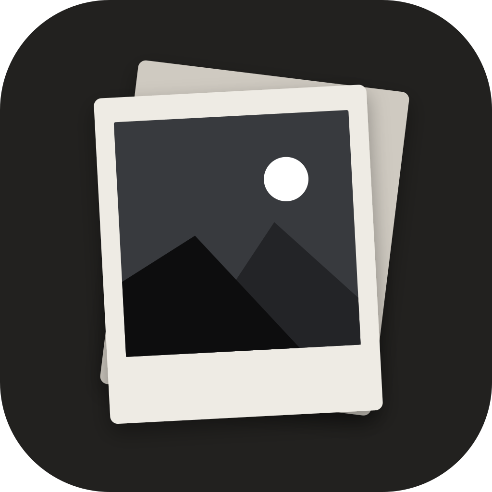
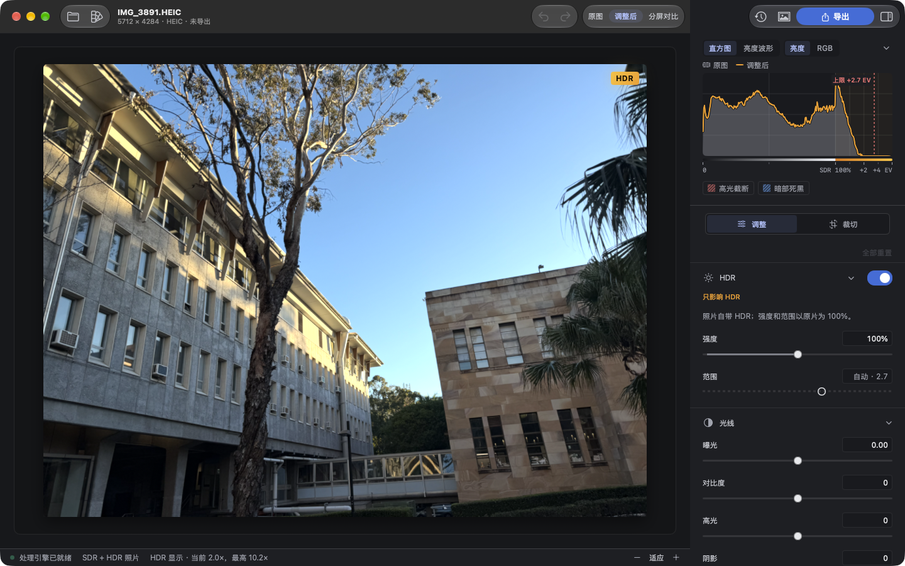
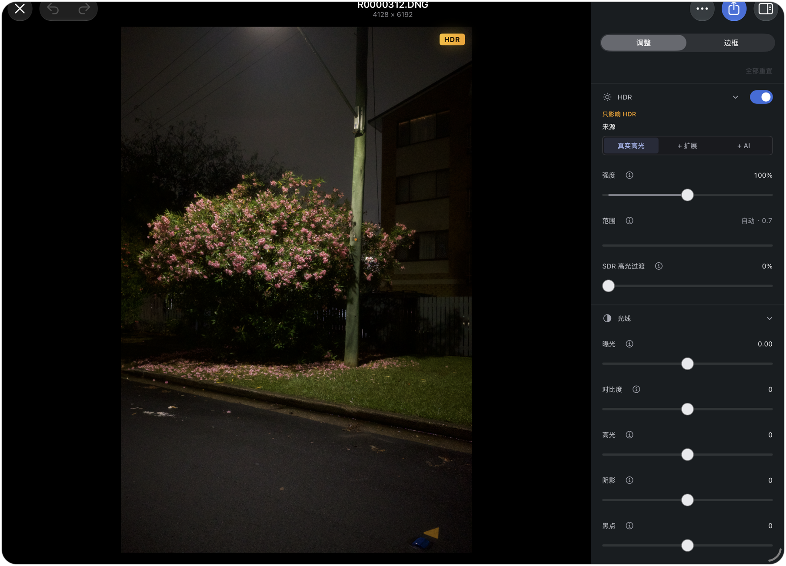
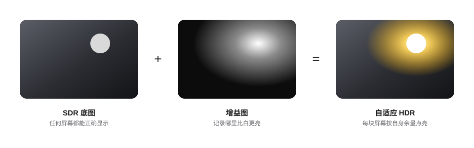
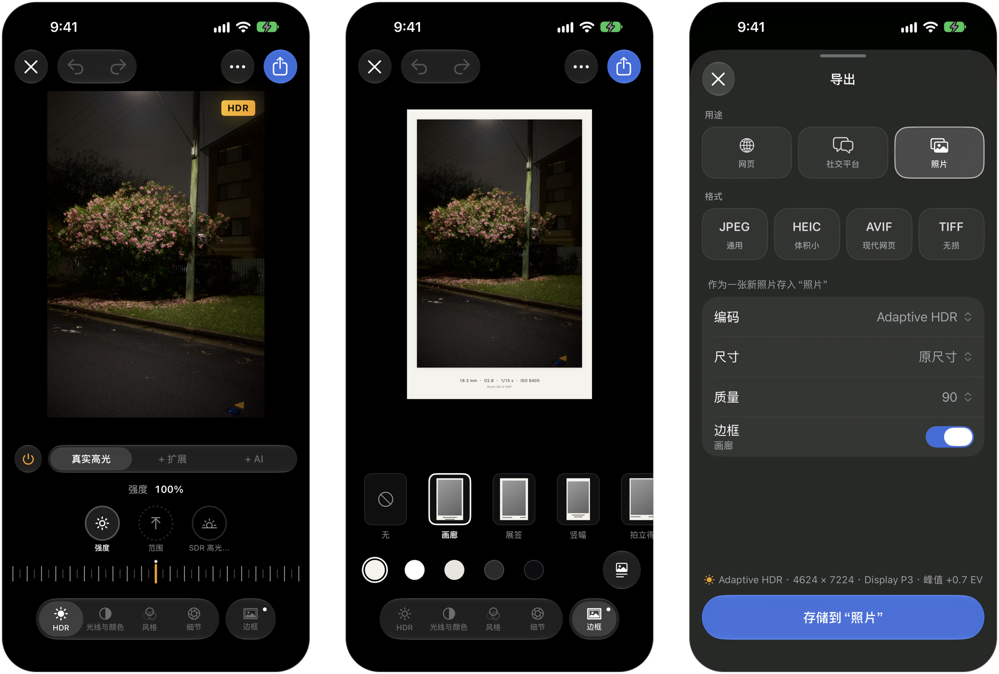
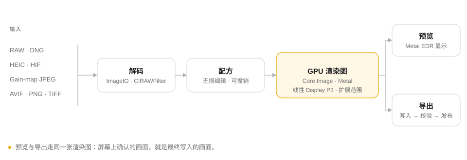

<p align="center">
  
</p>

<h1 align="center">HyperDR</h1>

<p align="center">
  <b>从拍下到导出，全程 HDR 的照片编辑。</b><br>
  iPhone · iPad · Mac
</p>

<p align="center">
  <a href="README.md">English</a>&nbsp;&nbsp;·&nbsp;&nbsp;简体中文
</p>

<p align="center">
  <a href="https://github.com/wsnxxxs/HyperDR/releases">下载 Mac 版</a>&nbsp;&nbsp;·&nbsp;&nbsp;<a href="apps/apple/README-iOS.md">构建 iPhone 与 iPad 版</a>&nbsp;&nbsp;·&nbsp;&nbsp;<a href="CHANGELOG.md">更新内容</a>
</p>

<br>

<p align="center">
  
</p>

<br>

现在的 iPhone 和相机拍下的照片里，本来就保存着比白色更亮的高光，Mac、iPhone 和 iPad 的屏幕也能把它们真正点亮。可多数修图软件一动滑块，就把照片压回了普通的 SDR，那部分光也就丢了。HyperDR 从读取相机文件到写出成片，始终保留这部分高光，并在你编辑时按屏幕真实的亮度余量把它显示出来。

<br>

## HDR 是主角，不是附带

画布是一个 Metal EDR 图层，高光在屏幕上能亮到多少就显示多少。随时按住画布可以查看原图，也可以切成分屏对照前后差别。HDR 有自己的来源和一组专门的调整：

- **真实高光**：直接使用相机在 RAW、HIF、HEIC 或增益图文件里记录的高光。
- **+ 扩展**：把已有的高光向更大的余量延展。
- **+ AI**：由设备上的神经网络推断文件里从未保存过的高光。

### 用神经网络为普通照片补回 HDR

很多照片本身没有任何 HDR 信息，比如一张普通的 JPEG、一张从网上存下来的图，或者很早的照片。HyperDR 内置了一个自训练的小型卷积神经网络，用于推断出它的高光原本应该亮多少。使用那种克制、自然的提亮方式优化，不会把整张图一起拉亮。

模型大约有 63.5 万个参数，通过 Core ML 在设备上运行。可以用强度、范围和起始亮度继续调整；若照片本身已有相机 raw 记录的高光时，也可以只让 AI 补上文件里缺的那部分。它始终基于同一份显影推断。

训练好的模型权重不公开。从本仓库构建的版本提供“真实高光”和“扩展”，AI 来源显示为不可用。

<br>

<p align="center">
  
</p>

<p align="center"><sub>iPad 上的 Studio 工作台</sub></p>

<br>

## 胶片风格，认得色彩空间的 LUT

- **胶片**：Kodak Portra 400、Gold 200、Kodachrome 64、Vision3 500T 和 Fujifilm Velvia 100。可以单独关掉防光晕层，做出像 CineStill 改造 Vision3 500T 那样在高光边缘透出红晕的效果。
- **颗粒与光晕**：按乳剂的物理散射过程计算，不是贴上去的纹理；任何照片都能用，不论有没有套用风格。
- **LUT**：把 `.cube` 文件导入 HyperDR 自己的 LUT 库。每个 LUT 都记得自己的输入和输出色彩空间，照片给不了它需要的输入时就会被禁用，而不是假装它是 sRGB 硬套上去。
- **相机 Log**：S-Log3、V-Log、F-Log2、LogC3、LogC4、Canon Log 3 的 LUT 会接收按场景线性重新显影的 RAW，保留文件自己的基准曝光、关闭色域压缩，让 18% 中灰正好落在曲线预期的位置。

挑选时，每个风格都直接用你这张照片渲染出小样。强度在线性光里混合；风格只改变颜色和 SDR 画面，HDR 高光会保留下来。

<br>

## 在每块屏幕上都对的导出

<p align="center">
  
</p>

自适应 HDR 在一个文件里放着你调好的 SDR 画面和一张 ISO 21496-1 增益图。普通屏幕显示 SDR 画面，HDR 屏幕把高光点亮到它能达到的程度。选好用途，比如网页、社交平台或照片，格式、尺寸和质量都会自动定好；改动任意一项，就成了你自己的格式。

| 输出 | 编码 |
|---|---|
| **自适应 HDR HEIC** | SDR 底图 + ISO 21496-1 增益图，HEVC |
| **增益图 JPEG** | SDR 底图 + ISO 21496-1 增益图 |
| **HDR HEIC · AVIF** | PQ 或 HLG，10 位 |
| **SDR** | JPEG · HEIC · TIFF |

### 用来展示作品的边框

<p align="center">
  
</p>

Gallery、Label、Story、Hairline 和 Instant 五种样式，每种都有五种纸张色调，可以加阴影，以及从照片自己的 EXIF 读出的说明文字，比如机身、镜头、光圈和快门。边框的纸张是用严格为零的增益写进去的，所以在 HDR 屏幕上只有照片本身会亮起来，卡纸始终是安静的纸白。Mac 的边框面板和 iPad 的导出灯箱都会在实时的 EDR 画布上预览带框效果，和写出的文件一致。

<br>

## 屏幕上确认的，就是写出的

<p align="center">
  
</p>

预览和导出走的是同一张 GPU 渲染图，由 Core Image 加上我们自己的 Metal 内核组成，在扩展范围的线性 Display P3 下计算，没有另一套导出引擎去重新解读你的编辑。裁切、旋转、透视校正和一键自动水平也是同一份配方的一部分。每个文件写完都会读回来校验，通过之后才交给“文件”、“照片”或分享面板。

**编辑不会漂移。** RAW 由 Apple 的 `CIRAWFilter` 显影，所用的解码器版本会和编辑一起保存。下次打开、换一台设备或者系统升级之后，照片都会用同一个解码器显影；如果那个解码器不可用了，HyperDR 会直接告诉你，而不是悄悄显示另一种结果。

**私密、自成一体。** HyperDR 没有自己的照片库，只读取你在系统选择器里挑出的照片，所有处理都在设备上完成。HEIF 的读写是我们自己的容器代码，HEVC 交给 VideoToolbox；应用里不嵌入任何动态库，也不含 (L)GPL 代码。

**不怕大文件。** 61MP 的 RAW 和 60MP 的 HIF 已经可以在 iPhone 17 Pro 上打开、按 1:1 平移并全尺寸导出。

<br>

## 格式

|  | |
|---|---|
| **打开** | Apple 解码器支持的相机 RAW（DNG、ARW、CR3、NEF、RAF、ORF、RW2 等）· HEIC / HEIF / HIF · AVIF · JPEG（含增益图 JPEG）· PNG · TIFF |
| **写出** | 自适应 HDR HEIC · 增益图 JPEG · PQ / HLG 的 HEIC 与 AVIF · SDR 的 JPEG、HEIC 与 TIFF |
| **存到** | 文件 · 照片（作为一张新照片）· 分享面板 |

## 获取 HyperDR

**Mac**：在 [Releases](https://github.com/wsnxxxs/HyperDR/releases) 下载最新版本，解压后把 `HyperDR.app` 拖进“应用程序”。这个版本是临时签名、没有经过公证的，如果 macOS 拦下了第一次启动，到“系统设置”→“隐私与安全性”里选择“仍要打开”即可。

**iPhone 与 iPad**：用 Xcode 和免费的个人 Apple ID（Personal Team）从源码构建安装，不需要付费开发者账号，步骤见[安装说明](apps/apple/README-iOS.md)。

需要 iOS / iPadOS 27，或 Apple 芯片上的 macOS 27。

> [!NOTE]
> HyperDR 0.5.2 还是预发布版本。iPhone 上 110MP RAW 的全尺寸处理还在验证，iOS 也暂时不能在后台继续导出。

<br>

## 开发者

<details>
<summary><b>架构</b></summary>
<br>

| 层 | 位置 | 作用 |
|---|---|---|
| 应用 | `apps/apple/HyperDR`、`apps/apple/HyperDRiOS` | Mac 版，以及 iPhone 与 iPad 版的 SwiftUI 界面 |
| 共享编辑器 | `apps/apple/Shared` | `RecipeEditor`、EDR 画布、裁切、示波器、导出快照、边框 |
| 配方与渲染 | `Packages/HyperDRRecipe`、`Packages/HyperDRRender` | 以数据表示的编辑；GPU 渲染图（Core Image + Metal、Core ML） |
| 服务 | `Packages/HyperDRKit` | 输入格式、会话、导出规划与 `RecipeExportService` |
| 引擎 | `modules/` | C++ 写入器、HEIF 与图像读取、VideoToolbox 编解码、有界校验，只通过 `modules/capi/include/hyperdr/hyperdr.h` 的 C ABI 调用 |
| 模型 | `HyperDR_Model` | AI 高光模型的训练代码 |

核心包不依赖 AppKit 或 UIKit。Swift 直接调用 C ABI，不使用 C++ 互操作。

</details>

<details>
<summary><b>构建与测试</b></summary>
<br>

需要装有 Xcode（含 iOS 与 Metal 工具链）的 macOS、CMake、Ninja、vcpkg 和 Python 3.12。依赖版本固定在 `vcpkg.json` 里；每个构建目录要使用各自的 vcpkg 安装根目录。

```sh
export DEVELOPER_DIR=/Applications/Xcode.app/Contents/Developer
python3.12 scripts/fetch_test_fixtures.py
python3.12 scripts/test.py native --build-dir build   # C++ 引擎
python3.12 scripts/test.py apple                      # xcframework、Swift 包、Mac 应用与本地化检查
python3.12 scripts/test.py ios                        # iPhone 与 iPad 的设备和模拟器无签名构建
```

`bash scripts/build_xcframework.sh --platforms all` 会构建全部三个 arm64 切片，并检查每个归档里是否含有 (L)GPL 符号。本地质量门槛见 [tests/quality](tests/quality/README.md)；解析器模糊测试位于 `tests/fuzz`，按需开启。

</details>

<br>

## 许可

HyperDR 采用 [GNU AGPL v3.0](LICENSE) 与商业许可双重授权，详见 [LICENSING.md](LICENSING.md)。HyperDR 的名称和应用图标不在这两种许可的范围内。第三方组件各自保留原有许可，见 [THIRD_PARTY_NOTICES.md](THIRD_PARTY_NOTICES.md)。
